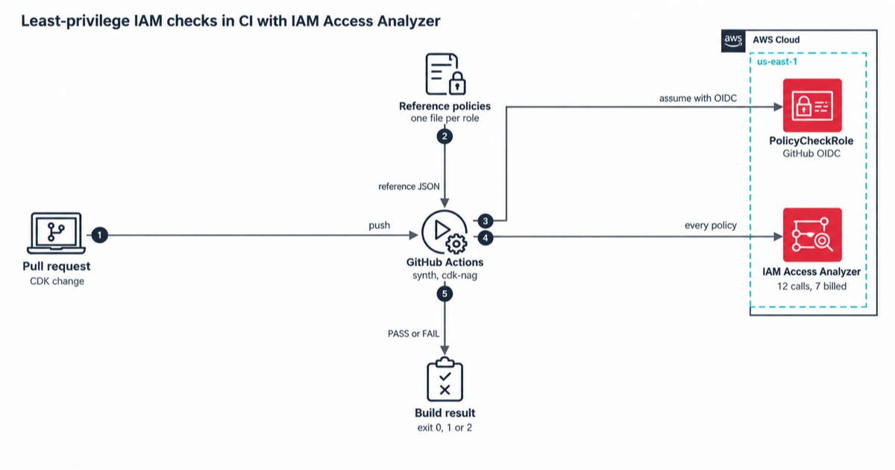

# Least-privilege IAM you can test in CI

This repo checks every IAM policy in an AWS Cloud Development Kit (CDK) app with IAM Access Analyzer, on every pull request. A role that gains an action its reference policy doesn't allow fails the build. So does a bucket policy that opens a bucket to the public.

The app itself is small on purpose. One AWS Lambda function exports a day of orders from Amazon DynamoDB to a JSON file in Amazon S3. Its role can run `dynamodb:Query` on one table and `s3:PutObject` under `exports/` in one bucket, and write its own logs. A test checks that the handler calls exactly those actions.

## Architecture



## What runs where

| Check | What it catches | Needs AWS? | Cost |
|---|---|---|---|
| cdk-nag (AWS Solutions pack) on every synth | Wildcard actions and resources, AWS managed policies, missing TLS and other known bad patterns | No | Free |
| `policy-check --dry-run` | A role with no reference policy, a role that grants an action its reference doesn't list, an AWS managed policy we can't see, a policy we can't read | No | Free |
| `ValidatePolicy` | Policy grammar errors and over-broad grants (findings of type ERROR or SECURITY_WARNING fail the build) | Yes | No charge |
| `CheckNoNewAccess` | A role that can do more than its reference policy in `policy-check/reference/` | Yes | $0.002 per call |
| `CheckAccessNotGranted` | Any role that can call an action on the never-grant list, such as `iam:PassRole` | Yes | $0.002 per call |
| `CheckNoPublicAccess` | A bucket policy or trust policy that grants public access | Yes | $0.002 per call |

One full run against this app makes 12 Access Analyzer calls. AWS bills 7 of them as custom checks, so a run costs $0.014 (sources and the math in [docs/cost.md](docs/cost.md)).

## How the policy check works

1. `cdk synth` writes the CloudFormation templates to `cdk.out/`.
2. `policy-check/extract.ts` finds every policy: inline role policies, `AWS::IAM::Policy`, managed policies, trust policies, and bucket, queue, topic, key and secret policies.
3. `policy-check/resolve.ts` replaces `Ref`, `Fn::GetAtt`, `Fn::Join` and `Fn::Sub` with placeholder values that have the right shape. An S3 bucket ARN becomes `arn:aws:s3:::<logical id>`, in account `123456789012`. Anything it can't resolve stops the run.
4. The extractor groups identity policies by role, because a role's real access is all of its policies together. The check compares each role with the reference policy that `policy-check/config.ts` maps to it.
5. `policy-check/checks.ts` sends each policy to the right Access Analyzer API and fails on anything other than `PASS`.

## Try it

You need Node.js 24 and npm. Docker is only needed for the DynamoDB Local test.

```bash
npm ci
npm run check                      # type check, lint, tests, synth with cdk-nag, dry run
docker run -d --rm -p 8024:8000 amazon/dynamodb-local:3.3.2
AWS_ENDPOINT_URL_DYNAMODB=http://localhost:8024 npm run test:int
AWS_ENDPOINT_URL_DYNAMODB=http://localhost:8024 npm run mutate   # break each safeguard, expect a test to fail
```

To run the real checks you need AWS credentials allowed to call the four Access Analyzer actions:

```bash
npm run synth
npm run policy-check -- --report policy-report.json
```

Exit code 0 means every check passed, 1 means a check failed, and 2 means the tool itself failed (no credentials, a template it can't read).

## Turn on the real check in CI

The `access-analyzer` job in `.github/workflows/ci.yml` does a dry run until you give it an AWS role. It doesn't wait for the `check` job, and it synthesizes with `-c nag=false` (`npm run synth:no-nag`), so a change that cdk-nag rejects still gets an Access Analyzer verdict. The `check` job keeps cdk-nag on. [docs/runbook.md](docs/runbook.md) walks through deploying the `IamPolicyCi-CiRole` stack and setting the `POLICY_CHECK_ROLE_ARN` repository variable. A pull request from a fork gets the dry run, because GitHub doesn't give fork workflows an OIDC token.

## Widening a role on purpose

Change the role in the stack, then change its reference file in `policy-check/reference/` in the same pull request. The reviewer sees the new access twice, once in code and once in the reference, and CI shows that the two agree.

## Limits

- Placeholder ARNs are not your real ARNs. The check proves what the policy allows relative to the reference, in the shape of your resources. It doesn't know your account's real resource names.
- The tool doesn't read `AWS::Lambda::Permission`, ECR repository policies and a few other types yet. The output lists them as "not checked".
- A policy attached to a role from another stack fails the run, because the tool can't see that role's other policies.
- Access Analyzer errs toward failing a check when it can't decide. You may see a FAIL that a careful reading says is fine. Change the policy or the reference; don't skip the check.

## Layout

| Path | What's there |
|---|---|
| `app/src/export-handler.ts` | The Lambda handler |
| `infra/lib/export-stack.ts` | The app: table, bucket, function, hand-written role |
| `infra/lib/ci-role-stack.ts` | The GitHub Actions role for the real policy check |
| `policy-check/` | The extractor, resolver, checks, config and reference policies |
| `test/` | Unit, policy, infra and DynamoDB Local tests |
| `docs/` | Security notes, cost and the runbook |

## License

MIT-0, in [LICENSE](LICENSE). Use the code however you like.

---

Created by Rahul Ladumor / InfraTales
